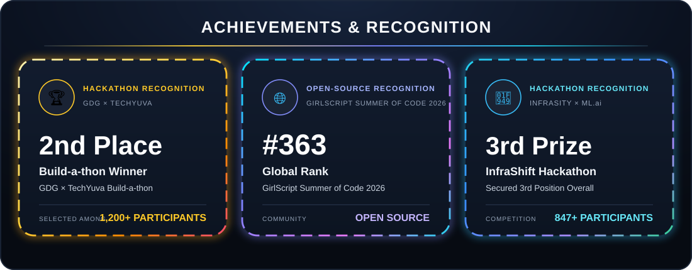

  

A passionate aspiring AI Engineer || Fast Learner || Enthusiastic about DSA 

Email Me 👉 ✉️ **suryansh.01868@gmail.com** For Collaboration/Project or Anything Else. 😊😊

* 🔭 **I’m currently working on:** Academic and personal projects focused on problem-solving and core computer science concepts
* 🌱 **I’m currently learning:** C++ and Python
* 👯 **I’m looking to collaborate on:** Beginner to intermediate projects in C++, Python, and algorithmic problem-solving
* 🤔 **I’m looking for help with:** Strengthening DSA fundamentals and building industry-relevant projects
* 💬 **Ask me about:** Collaboration, C/C++, Python, and learning strategies for engineering students
* 📫 **How to reach me:** [suryansh.01868@gmail.com](mailto:suryansh.01868@gmail.com)
* 😄 **Pronouns:** Suryansh
* ⚡ **Fun fact:** I enjoy exploring new technologies and continuously improving my technical skills

## 🌐 Socials:

  
  
  
  
  

<!-- Snake Game Repo View -->

  

# 💻 Tech Stack:
       

<!--- Achivement Section--->

  

<!-- Enhanced Coding-Themed Animated SVG (Bigger Text + Attractive Font) -->

  

  

### 📊 GitHub Stats 

 

### ✍️ Random Dev Quote

<!-- Proudly created with GPRM ( https://gprm.itsvg.in ) -->
